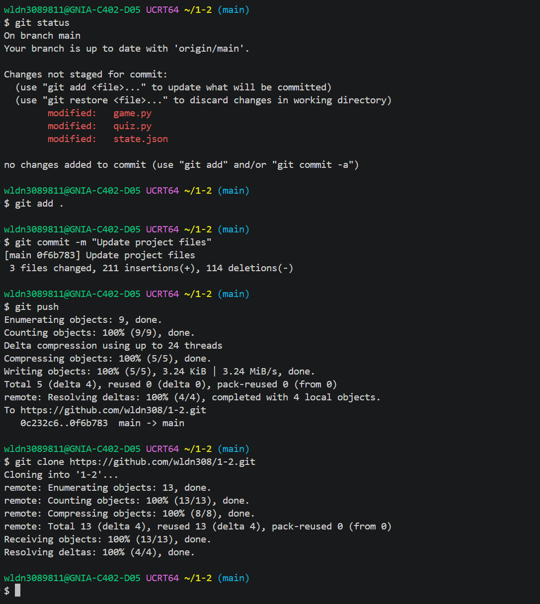
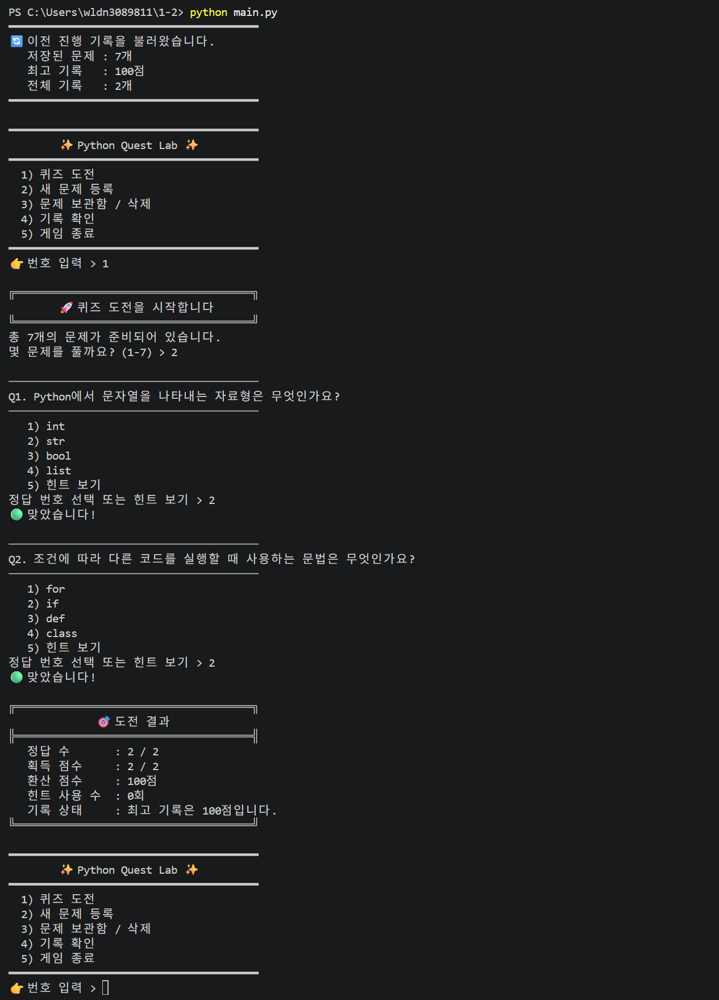
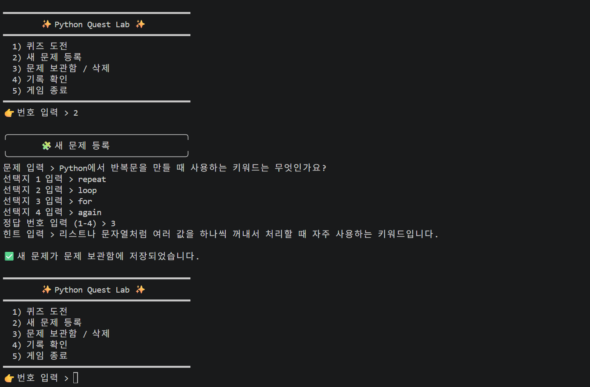
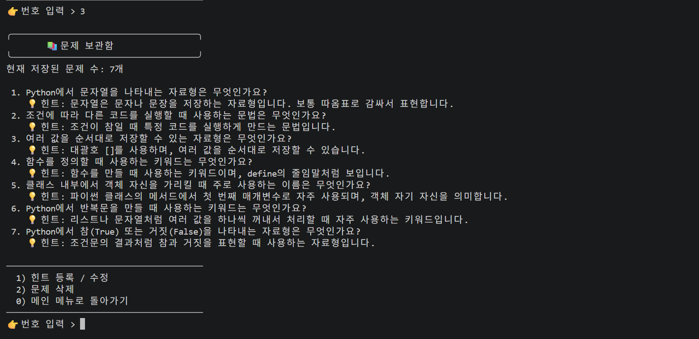
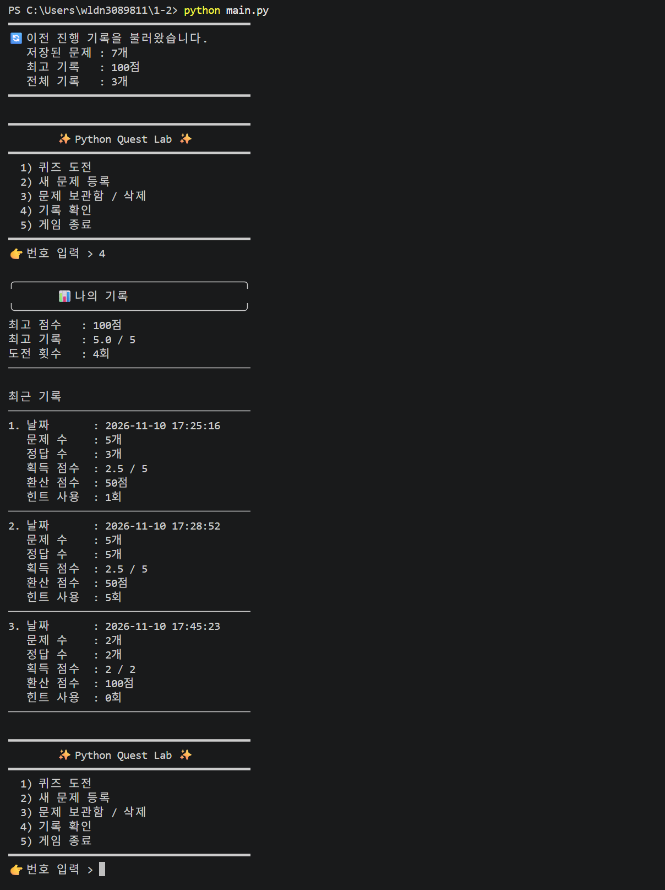
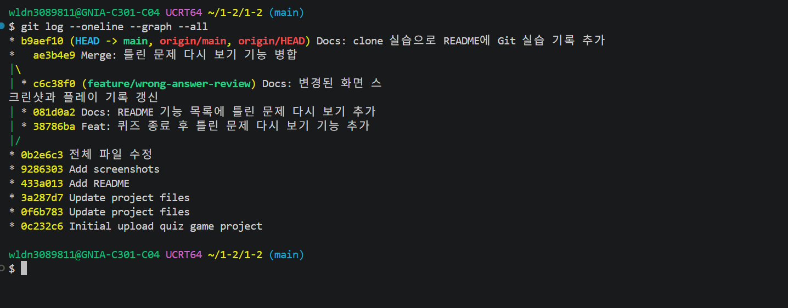

# Python Quest Lab

Python Quest Lab은 파이썬 기초 개념을 퀴즈 형식으로 학습할 수 있는 콘솔 기반 퀴즈 게임입니다.

사용자는 등록된 문제를 풀고 점수를 확인할 수 있으며, 직접 새로운 문제를 추가하거나 기존 문제를 삭제할 수 있습니다. 또한 퀴즈 기록과 최고 점수는 `state.json` 파일에 저장되어 프로그램을 다시 실행해도 이전 데이터를 이어서 사용할 수 있습니다.

- GitHub 저장소: https://github.com/wldn308/1-2

---

## 1. 프로젝트 개요

이 프로젝트는 Python의 기본 문법과 객체지향 프로그래밍을 활용하여 만든 퀴즈 게임입니다.

주요 목표는 다음과 같습니다.

- Python 기초 문법 복습
- 클래스와 객체 활용 연습
- JSON 파일을 이용한 데이터 저장 및 불러오기
- 사용자 입력 처리와 예외 처리 구현
- 랜덤 출제, 힌트, 기록 저장 기능 구현
- GitHub를 활용한 프로젝트 관리 경험

프로그램은 콘솔 환경에서 실행되며, 메뉴를 통해 퀴즈 풀기, 문제 추가, 문제 목록 확인, 힌트 수정, 문제 삭제, 점수 및 기록 확인 기능을 사용할 수 있습니다.

---

## 2. 퀴즈 주제 선정 이유

퀴즈 주제는 **Python 기초 문법**으로 선정했습니다.

Python은 프로그래밍을 처음 배울 때 많이 사용하는 언어이며, 변수, 자료형, 조건문, 함수, 클래스 같은 기본 개념을 이해하는 것이 중요합니다.

단순히 개념을 읽기만 하는 것보다 퀴즈 형식으로 직접 정답을 고르면서 학습하면 내용을 더 쉽게 기억할 수 있습니다. 또한 사용자가 직접 문제를 추가할 수 있도록 하여, 자신이 공부한 내용을 바탕으로 새로운 퀴즈를 만들며 복습할 수 있도록 했습니다.

기본 퀴즈는 다음과 같은 Python 기초 개념을 다룹니다.

- 문자열 자료형
- 조건문
- 리스트
- 함수 정의
- 클래스의 `self`
- 반복문
- Boolean 자료형

---

## 3. 실행 방법

### 3-1. 프로젝트 파일 준비

프로젝트 폴더 안에 다음 파일들이 있어야 합니다.

```text
main.py
game.py
quiz.py
state.json
README.md
.gitignore
benchmark.py
screenshots/
```

`state.json` 파일이 없으면 프로그램이 첫 실행 시 기본 퀴즈 7개로 시작하고, 같은 위치에 `state.json` 파일을 새로 생성합니다.

---

### 3-2. 실행 명령어

터미널에서 프로젝트 폴더로 이동한 뒤 아래 명령어를 입력합니다.

```bash
python main.py
```

환경에 따라 아래 명령어를 사용할 수도 있습니다.

```bash
python3 main.py
```

---

## 4. 기능 목록

### 4-1. 퀴즈 풀기

등록된 문제 중 원하는 개수만큼 문제를 선택하여 풀 수 있습니다.

주요 기능은 다음과 같습니다.

- 등록된 문제 중 랜덤 출제
- 풀 문제 개수 선택 가능
- 객관식 4지선다 문제 제공
- 힌트 보기 기능 제공
- 정답 여부 확인
- 퀴즈 종료 후 점수와 결과 출력
- 틀린 문제 다시 보기 (내가 고른 답과 정답 비교)

정답을 맞히면 1점을 얻습니다. 힌트를 사용한 문제는 맞히더라도 0.5점만 부여됩니다. 힌트는 문제당 한 번만 볼 수 있습니다.

---

### 4-2. 문제 추가

사용자가 직접 새로운 문제를 등록할 수 있습니다.

입력 항목은 다음과 같습니다.

- 문제 내용
- 선택지 4개
- 정답 번호
- 힌트

추가한 문제는 `state.json` 파일에 저장되며, 프로그램을 종료한 뒤 다시 실행해도 유지됩니다.

---

### 4-3. 문제 목록 확인

메인 메뉴의 `3) 문제 보관함`에서 현재 저장된 문제 목록을 확인할 수 있습니다.

확인 가능한 내용은 다음과 같습니다.

- 저장된 문제 번호
- 문제 내용
- 등록된 힌트

이를 통해 어떤 문제가 저장되어 있는지 쉽게 확인할 수 있습니다.

---

### 4-4. 문제 삭제

문제 보관함에서 `2) 문제 삭제`를 선택한 뒤, 삭제할 문제 번호를 입력하고 확인(y/n)을 거쳐 삭제할 수 있습니다.

삭제 기능은 잘못 등록한 문제나 더 이상 사용하지 않는 문제를 정리할 때 사용할 수 있습니다. 삭제된 결과는 `state.json` 파일에 저장됩니다.

---

### 4-5. 힌트 등록 및 수정

각 문제에는 힌트를 등록할 수 있습니다.

힌트는 사용자가 문제를 풀 때 정답을 떠올릴 수 있도록 도와주는 역할을 합니다. 새 문제를 등록할 때 힌트를 함께 입력하며, 이미 저장된 문제의 힌트는 문제 보관함에서 `1) 힌트 등록 / 수정`을 선택해 바꿀 수 있습니다. 기존 `state.json`에 힌트가 없는 문제는 "등록된 힌트가 없습니다."로 표시되며, 이 기능으로 힌트를 새로 등록할 수 있습니다.

---

### 4-6. 점수 및 기록 확인

퀴즈를 푼 뒤 결과가 저장되며, 기록 확인 기능을 통해 이전 플레이 기록을 볼 수 있습니다.

확인 가능한 정보는 다음과 같습니다.

- 최고 점수
- 최고 기록의 전체 문제 수
- 총 도전 횟수
- 최근 퀴즈 기록
- 푼 문제 수
- 맞힌 문제 수
- 획득 점수
- 환산 점수
- 힌트 사용 횟수

---

### 4-7. 데이터 저장 및 불러오기

프로그램은 퀴즈 문제와 플레이 기록을 `state.json` 파일에 저장합니다.

저장되는 데이터는 다음과 같습니다.

- 문제 목록
- 각 문제의 선택지와 정답
- 각 문제의 힌트
- 최고 점수
- 총 플레이 횟수
- 퀴즈 풀이 기록

프로그램을 다시 실행하면 `state.json` 파일을 읽어 이전 데이터를 불러옵니다.

---

## 5. 파일 구조

프로젝트의 기본 파일 구조는 다음과 같습니다.

```text
프로젝트 폴더/
│
├── main.py
├── game.py
├── quiz.py
├── state.json
├── README.md
├── .gitignore
├── benchmark.py
└── screenshots/
    ├── git.png
    ├── git_log.png
    ├── hint.png
    ├── list.png
    ├── quiz.png
    └── record.png
```

---

## 6. 파일 설명

### 6-1. `main.py`

프로그램 실행을 시작하는 파일입니다.

`QuizGame` 객체를 생성하고 게임을 실행하는 역할을 합니다.

예시 구조는 다음과 같습니다.

```python
from game import QuizGame

game = QuizGame()
game.run()
```

---

### 6-2. `game.py`

퀴즈 게임의 전체 진행을 담당하는 파일입니다.

주요 역할은 다음과 같습니다.

- 메인 메뉴 출력
- 퀴즈 실행
- 문제 추가
- 문제 목록 출력
- 힌트 등록 및 수정
- 문제 삭제
- 점수 계산
- 기록 저장
- `state.json` 저장 및 불러오기
- 사용자 입력 예외 처리

`QuizGame` 클래스가 정의되어 있으며, 실제 게임의 대부분 기능이 이 파일에서 동작합니다.

---

### 6-3. `quiz.py`

개별 퀴즈 문제를 표현하는 `Quiz` 클래스가 정의된 파일입니다.

주요 역할은 다음과 같습니다.

- 문제 내용 저장
- 선택지 저장
- 정답 번호 저장
- 힌트 저장
- 퀴즈 화면 출력
- 힌트 수정
- 정답 확인
- 객체 데이터를 딕셔너리 형태로 변환
- 저장된 딕셔너리 데이터를 다시 `Quiz` 객체로 변환

---

### 6-4. `state.json`

퀴즈 문제와 플레이 기록을 저장하는 데이터 파일입니다.

프로그램이 실행될 때 이 파일을 읽어 이전 데이터를 불러오고, 문제를 추가하거나 삭제하거나 퀴즈를 푼 뒤에는 변경된 내용을 다시 저장합니다.

---

### 6-5. `.gitignore`

Git에 올리지 않을 파일을 지정하는 파일입니다. `__pycache__/`, `*.pyc`, 가상환경 폴더(`.venv/`, `venv/`), `.env`, `.DS_Store`를 제외합니다.

---

### 6-6. `screenshots`

프로그램 실행 화면과 GitHub 업로드 과정을 저장한 이미지 폴더입니다.

README에서 실행 결과를 쉽게 확인할 수 있도록 다음 화면을 포함했습니다.

- GitHub 저장소 연동 및 push 과정
- 퀴즈 풀이 화면
- 힌트 및 문제 등록 화면
- 문제 목록 화면
- 기록 확인 화면

---

### 6-7. `benchmark.py`

퀴즈가 1,000개 이상으로 많아졌을 때 주요 동작(저장, 불러오기, 출제, 검색, 삭제)에 걸리는 시간과 메모리 사용량을 측정하는 스크립트입니다. 측정용 데이터는 메모리 안에서만 만들기 때문에 `state.json`은 바뀌지 않습니다. 측정 결과는 "14. 대량 데이터 성능 분석"에 정리했습니다.

```bash
python benchmark.py
```

---

## 7. 데이터 파일 설명

### 7-1. `state.json` 경로

`state.json` 파일은 프로젝트 폴더 안에 저장됩니다.

```text
프로젝트 폴더/state.json
```

프로그램은 `game.py`가 있는 폴더, 즉 프로젝트 루트를 기준으로 `state.json` 파일을 UTF-8 인코딩으로 읽고 저장합니다.

```python
STATE_FILE = Path(__file__).resolve().parent / "state.json"
```

이렇게 설정하면 프로그램을 어느 위치에서 실행하더라도 `game.py`가 있는 폴더의 `state.json` 파일을 사용할 수 있습니다.

---

### 7-2. `state.json` 역할

`state.json`은 프로그램의 저장 파일 역할을 합니다.

주요 역할은 다음과 같습니다.

1. 등록된 퀴즈 문제 저장
2. 문제별 선택지 저장
3. 문제별 정답 번호 저장
4. 문제별 힌트 저장
5. 최고 점수 저장
6. 총 플레이 횟수 저장
7. 최근 퀴즈 기록 저장
8. 프로그램 재실행 시 이전 상태 복원

---

### 7-3. `state.json` 필드 구조

`state.json` 파일은 다음과 같은 구조를 가집니다.

```json
{
    "quizzes": [
        {
            "question": "Python에서 문자열을 나타내는 자료형은 무엇인가요?",
            "choices": [
                "int",
                "str",
                "bool",
                "list"
            ],
            "answer": 2,
            "hint": "문자열은 문자나 문장을 저장하는 자료형입니다. 보통 따옴표로 감싸서 표현합니다."
        }
    ],
    "best_score": 1,
    "best_total": 1,
    "played_count": 1,
    "history": [
        {
            "datetime": "2026-01-01 12:00:00",
            "question_count": 1,
            "correct_count": 1,
            "score": 1,
            "total": 1,
            "percent": 100,
            "hint_count": 0
        }
    ]
}
```

---

## 8. 주요 필드 설명

### 8-1. `quizzes`

퀴즈 문제 목록을 저장하는 배열입니다.

각 문제는 다음 필드를 가집니다.

| 필드명 | 설명 |
|---|---|
| `question` | 문제 내용 |
| `choices` | 객관식 선택지 목록 |
| `answer` | 정답 번호 |
| `hint` | 문제 힌트 |

예시:

```json
{
    "question": "함수를 정의할 때 사용하는 키워드는 무엇인가요?",
    "choices": [
        "function",
        "def",
        "make",
        "return"
    ],
    "answer": 2,
    "hint": "함수를 만들 때 사용하는 키워드이며, define의 줄임말처럼 보입니다."
}
```

---

### 8-2. `best_score`

현재까지 기록한 최고 점수를 저장합니다.

예시:

```json
"best_score": 4
```

힌트 사용 여부에 따라 0.5점 단위의 점수가 저장될 수도 있습니다.

---

### 8-3. `best_total`

최고 기록을 달성했을 때의 전체 문제 수를 저장합니다.

예시:

```json
"best_total": 5
```

---

### 8-4. `played_count`

퀴즈에 도전한 총 횟수를 저장합니다.

예시:

```json
"played_count": 3
```

---

### 8-5. `history`

퀴즈 풀이 기록을 저장하는 배열입니다.

각 기록은 다음 필드를 가집니다.

| 필드명 | 설명 |
|---|---|
| `datetime` | 퀴즈를 푼 날짜와 시간 |
| `question_count` | 푼 문제 수 |
| `correct_count` | 맞힌 문제 수 |
| `score` | 획득 점수 |
| `total` | 전체 점수 |
| `percent` | 환산 점수 |
| `hint_count` | 힌트 사용 횟수 |

예시:

```json
{
    "datetime": "2026-01-01 12:00:00",
    "question_count": 5,
    "correct_count": 4,
    "score": 4,
    "total": 5,
    "percent": 80,
    "hint_count": 1
}
```

---

## 9. 기본 퀴즈 예시

기본 퀴즈는 Python 기초 개념을 중심으로 구성되어 있습니다.

예시는 다음과 같습니다.

| 번호 | 문제 주제 | 정답 |
|---|---|---|
| 1 | 문자열 자료형 | `str` |
| 2 | 조건문 | `if` |
| 3 | 여러 값을 순서대로 저장하는 자료형 | `list` |
| 4 | 함수 정의 키워드 | `def` |
| 5 | 클래스 내부에서 객체 자신을 가리키는 이름 | `self` |
| 6 | 반복문 키워드 | `for` |
| 7 | 참과 거짓을 나타내는 자료형 | `bool` |

각 문제에는 정답을 직접 알려주지 않으면서도 개념을 떠올릴 수 있도록 힌트가 함께 제공됩니다.

---

## 10. 예외 처리

프로그램은 안정적인 실행을 위해 여러 입력 상황을 처리합니다.

처리하는 상황은 다음과 같습니다.

- 숫자가 아닌 값을 입력한 경우
- 선택 가능한 범위를 벗어난 번호를 입력한 경우
- 빈 값을 입력한 경우
- `Ctrl + C`로 입력이 중단된 경우
- 입력 스트림이 종료된 경우
- `state.json` 파일이 없는 경우 (기본 퀴즈로 시작)
- `state.json` 파일이 손상된 경우 (JSON 문법 오류, UTF-8이 아닌 파일, 잘못된 구조나 값)
- 일부 문제 데이터만 잘못된 경우 (해당 문제만 제외하고 불러오기)
- 저장 파일을 읽거나 쓰는 중 문제가 발생한 경우

이러한 예외 처리를 통해 프로그램이 갑자기 종료되는 상황을 줄이고, 사용자에게 안내 메시지를 제공합니다.

### 10-1. 손상된 파일 백업과 복구 절차

`state.json`이 손상되었다고 판단되면, 기본 문제 세트로 덮어쓰기 전에 원본 파일을 같은 폴더의 `state.json.bak`으로 먼저 복사합니다. 그래서 복구 후에도 원래 데이터를 확인할 수 있습니다.

손상된 데이터를 되살리고 싶을 때의 절차는 다음과 같습니다.

1. 프로그램을 종료합니다.
2. `state.json.bak` 파일을 열어 잘못된 부분(괄호 누락, 쉼표 오류 등)을 고칩니다.
3. 현재 `state.json`을 지우고, 고친 `state.json.bak`의 이름을 `state.json`으로 바꿉니다.
4. 프로그램을 다시 실행해 기록이 정상적으로 불러와지는지 확인합니다.

`state.json.bak`은 `.gitignore`에 등록되어 있어 Git 저장소에는 올라가지 않습니다.

### 10-2. 안전한 저장 방식

저장할 때는 `state.json`에 바로 쓰지 않고, 임시 파일 `state.json.tmp`에 먼저 끝까지 저장한 뒤 `state.json`과 교체합니다. 저장 도중 오류가 발생하더라도 기존 `state.json`은 그대로 남기 때문에, 저장 실패로 파일이 망가지는 일을 막을 수 있습니다.

---

## 11. 사용한 주요 Python 개념

이 프로젝트에서 사용한 주요 Python 개념은 다음과 같습니다.

- 클래스와 객체
- 리스트
- 딕셔너리
- 조건문
- 반복문
- 함수
- 예외 처리
- JSON 파일 입출력
- 랜덤 출제
- 파일 경로 처리
- 날짜와 시간 기록

---

## 12. 실행 화면

아래 이미지는 프로그램의 주요 기능 실행 화면입니다.

### 12-1. GitHub 저장소 연동 및 push

README 작성 후 GitHub 저장소에 프로젝트 파일을 commit하고 push한 화면입니다.



---

### 12-2. 퀴즈 풀이 화면

사용자가 퀴즈 도전을 선택하고, 원하는 문제 수만큼 퀴즈를 푸는 화면입니다.



---

### 12-3. 힌트 및 문제 등록 화면

새 문제를 등록하면서 문제, 선택지, 정답 번호, 힌트를 입력하는 화면입니다.



---

### 12-4. 문제 목록 확인 화면

현재 저장된 문제 목록을 확인하고, 삭제할 문제를 선택할 수 있는 화면입니다.



---

### 12-5. 기록 확인 화면

퀴즈를 푼 뒤 저장된 최고 점수, 도전 횟수, 최근 기록을 확인하는 화면입니다.



---

### 12-6. 실행 로그 (텍스트)

`python main.py`로 실행한 뒤 메뉴 확인, 퀴즈 풀기, 점수 확인, 종료까지 진행한 터미널 출력입니다.

```text
$ "$PY" main.py
━━━━━━━━━━━━━━━━━━━━━━━━━━━━━━━━━━━━━━━━
🔄 이전 진행 기록을 불러왔습니다.
   저장된 문제 : 7개
   최고 기록   : 75점
   전체 기록   : 2개
━━━━━━━━━━━━━━━━━━━━━━━━━━━━━━━━━━━━━━━━

━━━━━━━━━━━━━━━━━━━━━━━━━━━━━━━━━━━━━━━━
        ✨ Python Quest Lab ✨
━━━━━━━━━━━━━━━━━━━━━━━━━━━━━━━━━━━━━━━━
  1) 퀴즈 도전
  2) 새 문제 등록
  3) 문제 보관함 (힌트 수정 / 삭제)
  4) 기록 확인
  5) 게임 종료
━━━━━━━━━━━━━━━━━━━━━━━━━━━━━━━━━━━━━━━━
👉 번호 입력 > 1

╔══════════════════════════════════════╗
        🚀 퀴즈 도전을 시작합니다
╚══════════════════════════════════════╝
총 7개의 문제가 준비되어 있습니다.
몇 문제를 풀까요? (1-7) > 3

────────────────────────────────────────
Q1. 함수를 정의할 때 사용하는 키워드는 무엇인가요?
────────────────────────────────────────
   1) function
   2) def
   3) make
   4) return
   5) 힌트 보기
정답 번호 선택 또는 힌트 보기 > 2
🟢 맞았습니다!

────────────────────────────────────────
Q2. Python에서 반복문을 만들 때 사용하는 키워드는 무엇인가요?
────────────────────────────────────────
   1) repeat
   2) loop
   3) for
   4) again
   5) 힌트 보기
정답 번호 선택 또는 힌트 보기 > 5
💡 힌트: 리스트나 문자열처럼 여러 값을 하나씩 꺼내서처리할 때 자주 사용하는 키워드입니다.
   힌트를 사용했으므로 맞히면 0.5점만 획득합니다.
정답 번호 선택 또는 힌트 보기 > 3
🟢 맞았습니다!

────────────────────────────────────────
Q3. 여러 값을 순서대로 저장할 수 있는 자료형은 무엇인가요?
────────────────────────────────────────
   1) list
   2) bool
   3) int
   4) None
   5) 힌트 보기
정답 번호 선택 또는 힌트 보기 > 2
🔴 아쉽습니다. 정답은 1번입니다.

╔══════════════════════════════════════╗
              🎯 도전 결과
╠══════════════════════════════════════╣
   정답 수       : 2 / 3
   획득 점수     : 1.5 / 3
   환산 점수     : 50점
   힌트 사용 수  : 1회
   기록 상태     : 최고 기록은 75점입니다.
╚══════════════════════════════════════╝

📝 틀린 문제 다시 보기
────────────────────────────────────────
Q. 여러 값을 순서대로 저장할 수 있는 자료형은 무엇인가요?
   내가 고른 답 : 2) bool
   정답         : 1) list
────────────────────────────────────────

━━━━━━━━━━━━━━━━━━━━━━━━━━━━━━━━━━━━━━━━
        ✨ Python Quest Lab ✨
━━━━━━━━━━━━━━━━━━━━━━━━━━━━━━━━━━━━━━━━
  1) 퀴즈 도전
  2) 새 문제 등록
  3) 문제 보관함 (힌트 수정 / 삭제)
  4) 기록 확인
  5) 게임 종료
━━━━━━━━━━━━━━━━━━━━━━━━━━━━━━━━━━━━━━━━
👉 번호 입력 > 4

╭──────────────────────────────────────╮
        📊 나의 기록
╰──────────────────────────────────────╯
최고 점수   : 75점
최고 기록   : 3.0 / 4
도전 횟수   : 3회
────────────────────────────────────────

최근 기록
────────────────────────────────────────
1. 날짜       : 2026-11-13 00:13:58
   문제 수    : 2개
   정답 수    : 1개
   획득 점수  : 1 / 2
   환산 점수  : 50점
   힌트 사용  : 0회
────────────────────────────────────────
2. 날짜       : 2026-11-13 01:01:20
   문제 수    : 4개
   정답 수    : 3개
   획득 점수  : 3 / 4
   환산 점수  : 75점
   힌트 사용  : 0회
────────────────────────────────────────
3. 날짜       : 2026-11-13 03:19:45
   문제 수    : 3개
   정답 수    : 2개
   획득 점수  : 1.5 / 3
   환산 점수  : 50점
   힌트 사용  : 1회
────────────────────────────────────────

━━━━━━━━━━━━━━━━━━━━━━━━━━━━━━━━━━━━━━━━
        ✨ Python Quest Lab ✨
━━━━━━━━━━━━━━━━━━━━━━━━━━━━━━━━━━━━━━━━
  1) 퀴즈 도전
  2) 새 문제 등록
  3) 문제 보관함 (힌트 수정 / 삭제)
  4) 기록 확인
  5) 게임 종료
━━━━━━━━━━━━━━━━━━━━━━━━━━━━━━━━━━━━━━━━
👉 번호 입력 > 5

👋 게임을 종료합니다. 다음에 또 도전해보세요!
✅ 프로그램을 안전하게 종료했습니다.
```

---

## 13. Git 실습 기록

### 13-1. 브랜치 생성 및 병합

`feature/wrong-answer-review` 브랜치를 만들어 퀴즈 종료 후 틀린 문제를 다시 보여주는 기능을 개발했습니다. 기능 구현, README 수정, 스크린샷 갱신을 각각 커밋한 뒤 `git merge --no-ff`로 main 브랜치에 병합했습니다.

### 13-2. clone 및 pull 실습

이 내용은 저장소를 별도 폴더에 clone한 뒤 추가하고 push했으며, 원래 작업 폴더에서 pull로 가져왔습니다.

### 13-3. 커밋 기록

`git log --oneline --graph --all` 실행 결과입니다. 브랜치가 갈라졌다가 main으로 병합된 흐름을 확인할 수 있습니다.



같은 결과를 텍스트로도 첨부합니다. 전체 커밋 기록은 [GitHub 커밋 목록](https://github.com/wldn308/1-2/commits/main)에서 확인할 수 있습니다.

```text
$ git log --oneline --graph --all
* 25d1752 (HEAD -> main) Chore: 대량 퀴즈 성능 측정 스크립트 추가
* 28d5cfc Fix: 손상된 저장 파일 자동 백업과 안전한 저장 방식 적용
* a1dc51a (origin/main, origin/HEAD) Docs: README에 Git 실습 기록과 커밋 그래프 추가
* b9aef10 Docs: clone 실습으로 README에 Git 실습 기록 추가
*   ae3b4e9 Merge: 틀린 문제 다시 보기 기능 병합
|\  
| * c6c38f0 (feature/wrong-answer-review) Docs: 변경된 화면 스크린샷과 플레이 기록 갱신
| * 081d0a2 Docs: README 기능 목록에 틀린 문제 다시 보기 추가
| * 38786ba Feat: 퀴즈 종료 후 틀린 문제 다시 보기 기능 추가
|/  
* 0b2e6c3 전체 파일 수정
* 9286303 Add screenshots
* 433a013 Add README
* 3a287d7 Update project files
* 0f6b783 Update project files
* 0c232c6 Initial upload quiz game project
```

### 13-4. 커밋 규칙

**커밋 단위 기준**

- 하나의 커밋에는 하나의 목적만 담습니다. (기능 하나 추가, 버그 하나 수정, 문서 한 부분 수정)
- 코드 변경과 문서 변경은 가능하면 별도 커밋으로 나눕니다.
- 프로그램이 정상적으로 실행되는 상태에서만 커밋합니다.
- 새 기능은 `feature/기능이름` 브랜치에서 작업한 뒤 main 브랜치에 병합합니다.

**커밋 메시지 템플릿**

```text
타입: 변경 내용 요약
```

변경 내용 요약은 무엇을 바꿨는지 드러나도록 한 줄로 작성합니다.

| 타입 | 사용하는 경우 | 예시 |
|---|---|---|
| `Feat` | 새 기능 추가 | `Feat: 퀴즈 종료 후 틀린 문제 다시 보기 기능 추가` |
| `Fix` | 버그 수정, 안정성 개선 | `Fix: 손상된 저장 파일 자동 백업과 안전한 저장 방식 적용` |
| `Docs` | README, 스크린샷 등 문서 수정 | `Docs: README 기능 목록에 틀린 문제 다시 보기 추가` |
| `Refactor` | 동작은 같고 코드 구조만 정리 | `Refactor: 입력 처리 메서드 분리` |
| `Chore` | 설정 파일, 측정 도구 등 기타 작업 | `Chore: 대량 퀴즈 성능 측정 스크립트 추가` |
| `Merge` | 브랜치 병합 | `Merge: 틀린 문제 다시 보기 기능 병합` |

초기 커밋 5개(`Initial upload ...`부터 `전체 파일 수정`까지)는 이 규칙을 정하기 전에 작성되어 형식이 다릅니다. 브랜치 작업부터 이 규칙을 적용했습니다.

---

## 14. 대량 데이터 성능 분석

퀴즈가 1,000개 이상으로 늘어났을 때도 프로그램이 문제없이 동작하는지 확인하기 위해, 주요 동작의 시간 복잡도를 분석하고 `benchmark.py`로 직접 측정했습니다.

### 14-1. 동작별 시간 복잡도

n은 전체 퀴즈 수, k는 한 번에 푸는 문제 수입니다.

| 동작 | 관련 코드 | 시간 복잡도 | 이유 |
|---|---|---|---|
| 불러오기 | `load_state` | O(n) | 모든 문제를 읽어 `Quiz` 객체로 변환 |
| 저장 | `save_state` | O(n) | 변경될 때마다 전체 데이터를 다시 저장 |
| 랜덤 출제 | `random.sample` | O(k) | 전체 수와 상관없이 뽑을 문제 수만큼만 처리 |
| 정답 확인 | `check_answer` | O(1) | 숫자 하나만 비교 |
| 목록 출력 | `show_quiz_list` | O(n) | 모든 문제를 화면에 출력 |
| 삭제 | `list.pop(i)` | O(n) | 삭제한 위치 뒤의 문제들이 한 칸씩 당겨짐 |

메모리는 프로그램 실행 중 모든 문제를 리스트에 올려 두기 때문에 문제 수에 비례해서 늘어납니다. (O(n))

### 14-2. 측정 결과

```text
[퀴즈 1,000개]
  객체 생성       :     2.10 ms
  저장 (JSON 변환):     0.88 ms
  불러오기        :     0.92 ms
  랜덤 10문제 출제:    0.021 ms
  검색 (최악)     :    0.013 ms
  삭제 (최악)     :    0.001 ms
  JSON 파일 크기  :    356.3 KB
  최대 메모리 사용:     0.40 MB

[퀴즈 10,000개]
  객체 생성       :    21.53 ms
  저장 (JSON 변환):     9.30 ms
  불러오기        :    10.88 ms
  랜덤 10문제 출제:    0.022 ms
  검색 (최악)     :    0.126 ms
  삭제 (최악)     :    0.003 ms
  JSON 파일 크기  :   3581.8 KB
  최대 메모리 사용:     4.02 MB

[퀴즈 100,000개]
  객체 생성       :   206.78 ms
  저장 (JSON 변환):   114.17 ms
  불러오기        :   168.34 ms
  랜덤 10문제 출제:    0.023 ms
  검색 (최악)     :    1.626 ms
  삭제 (최악)     :    0.032 ms
  JSON 파일 크기  :  36013.5 KB
  최대 메모리 사용:    40.58 MB
```

### 14-3. 분석과 개선 방향

- 퀴즈 1,000개 수준에서는 저장, 불러오기, 출제가 모두 수 밀리초 안에 끝나서 사용자가 느끼는 지연이 없습니다.
- 랜덤 출제는 전체 문제 수가 늘어나도 시간이 거의 변하지 않습니다.
- 저장과 불러오기는 문제 수에 비례해 느려집니다. 문제를 하나 추가하거나 삭제할 때마다 파일 전체를 다시 쓰기 때문입니다.
- 문제가 수천 개를 넘으면 목록 화면이 너무 길어지므로, 한 화면에 20개씩 나눠 보여주는 페이지 기능이 필요합니다.
- 문제가 수만 개 이상으로 늘어나면 JSON 파일 하나 대신, 필요한 데이터만 읽고 쓸 수 있는 데이터베이스(Python 표준 라이브러리의 `sqlite3`)로 바꾸는 것을 고려할 수 있습니다.

---

## 15. 마무리

Python Quest Lab은 Python 기초 개념을 재미있게 복습할 수 있도록 만든 퀴즈 게임입니다.

문제를 풀면서 기본 문법을 확인할 수 있고, 직접 문제를 추가하면서 학습 내용을 복습할 수 있습니다. 또한 점수와 기록이 저장되기 때문에 자신의 학습 진행 상황을 확인할 수 있습니다.

이번 프로젝트를 통해 Python의 클래스, 파일 입출력, 예외 처리, JSON 저장 방식, GitHub 사용 방법을 함께 연습할 수 있었습니다.